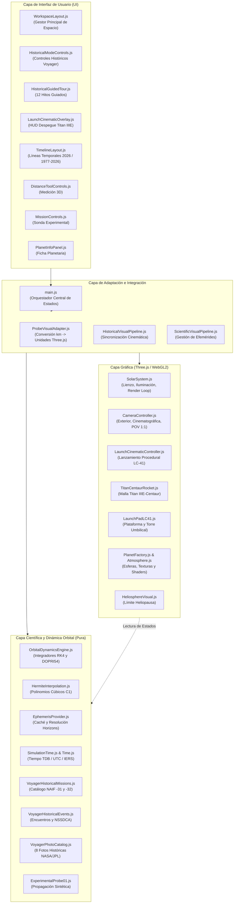

# 02. Arquitectura y Estado Técnico del Proyecto

**Proyecto:** Simulador de Sondas Espaciales (Sistema Solar y Misiones Voyager 1 y 2)  
**Fecha de Inspección:** 31 de octubre de 2026  
**Rama Activa:** `revision/modo-historico-voyager`  
**Estado del Árbol de Trabajo:** Limpio de modificaciones externas durante la auditoría; contiene archivos locales y pruebas de integración previas que reflejan el estado de desarrollo en curso.

---

## 1. Mapa de Módulos y Capas de la Aplicación

La aplicación sigue una **arquitectura en capas bien diferenciadas**, diseñada para desacoplar el cálculo matemático y físico de la representación visual y de la interfaz de usuario:



---

## 2. Inventario de Tecnologías y Dependencias

### Entorno y Herramientas Base
- **Lenguaje:** JavaScript ES Modules nativo (ECMAScript 2023+), sin transpilar con Babel, utilizando sintaxis moderna (`async/await`, `structuredClone`, `Object.freeze`, `#privates`).
- **Motor Gráfico:** `Three.js` versión **0.186.1** (módulos ES oficiales, con `OrbitControls`, `GLTFLoader`).
- **Empaquetador y Dev Server:** `Vite` versión **8.3.4** con compilador Rolldown experimental.
- **Entorno de Pruebas:** Node.js v24.14.0 nativo mediante `node --test` (sin dependencias externas tipo Jest o Mocha).
- **Control de Versiones:** Git (rama `revision/modo-historico-voyager`).

### Análisis de `package.json`
```json
{
  "name": "simulador-sondas-espaciales",
  "version": "0.0.0",
  "private": true,
  "type": "module",
  "scripts": {
    "dev": "vite",
    "build": "vite build",
    "preview": "vite preview"
  },
  "devDependencies": {
    "vite": "^8.3.0"
  },
  "dependencies": {
    "three": "^0.186.1"
  }
}
```
> [!NOTE]
> La huella de dependencias es deliberadamente mínima y extraordinariamente limpia: únicamente `three` en tiempo de ejecución y `vite` en desarrollo. Esto reduce la superficie de ataque, elimina vulnerabilidades de dependencias transitivas y asegura una compilación instantánea (647 ms).

---

## 3. Desglose Estructural de Carpetas

```
simulador-sondas-espaciales/
├── index.html                   <- Plantilla HTML semántica con sprites SVG y estructura inicial
├── package.json                 <- Manifiesto de dependencias y scripts Vite
├── vite.config.js               <- Configuración de despliegue y compatibilidad
├── public/                      <- Recursos estáticos servidos en la raíz
│   ├── favicon.svg              <- Icono vectorial oficial
│   ├── data/                    <- Efemérides JSON comprimidas y catálogo Hipparcos TSV
│   │   ├── efemerides-2026.json
│   │   ├── historical-ephemerides-catalog-v1.json
│   │   ├── hipparcos-vmag-6p5.tsv
│   │   └── historical/encounters/ (archivos de encuentro de Júpiter, Saturno, Urano, Neptuno)
│   ├── images/voyager/          <- 8 fotografías históricas NASA y miniaturas
│   ├── models/voyager/          <- Modelo oficial Voyager.glb (3.12 MB, NASA VTAD)
│   └── textures/                <- Mapas de texturas planetarias (2K/4K)
├── src/
│   ├── main.js                  <- Punto de entrada y orquestador general (1591 líneas)
│   ├── style.css                <- Estilos base, variables de diseño y utilidades HUD
│   ├── astronomy/               <- Adaptadores clásicos de efemérides (Ephemerides.js)
│   ├── graphics/                <- Subsistemas Three.js y WebGL
│   │   ├── Atmosphere.js        <- Shaders y capas de atmósfera
│   │   ├── CameraController.js  <- Gestor multimodal de cámaras (46 kB)
│   │   ├── HeliosphereVisual.js <- Malla volumétrica de la heliopausa
│   │   ├── LaunchCinematicController.js <- Secuencia cinemática Titan IIIE en LC-41
│   │   ├── LaunchPadLC41.js     <- Plataforma LC-41 y torre umbilical
│   │   ├── OverviewFraming.js   <- Algoritmo de encuadre orbital óptimo
│   │   ├── PlanetFactory.js     <- Geometrías esféricas planetarias y anillos
│   │   ├── ScaleModeConfig.js   <- Configuración de escalas Científica 1:1 y Exploratoria
│   │   ├── SolarSystem.js       <- Escena Three.js, luces, bucle RAF
│   │   └── TitanCentaurRocket.js <- Modelo procedural del Titan IIIE-Centaur
│   ├── integration/             <- Puentes entre matemáticas científicas y escena 3D
│   │   ├── HistoricalVisualPipeline.js
│   │   ├── ProbeVisualAdapter.js
│   │   └── ScientificVisualPipeline.js
│   ├── science/                 <- Núcleo astronómico y orbital (aislado de Three.js)
│   │   ├── DistanceMeasurement.js
│   │   ├── EphemerisProvider.js
│   │   ├── ExperimentalProbe01.js
│   │   ├── Frames.js
│   │   ├── HermiteInterpolation.js
│   │   ├── HistoricalEphemerisResolver.js
│   │   ├── HistoricalMissionEngine.js
│   │   ├── OrbitalDynamicsEngine.js
│   │   ├── SimulationTime.js
│   │   ├── Time.js
│   │   ├── Units.js
│   │   ├── VoyagerHistoricalEvents.js
│   │   ├── VoyagerHistoricalMissions.js
│   │   └── VoyagerPhotoCatalog.js
│   └── ui/                      <- Componentes interactivos de usuario y CSS modular
│       ├── DistanceToolControls.js
│       ├── HistoricalGuidedTour.js
│       ├── HistoricalModeControls.js
│       ├── HistoricalWelcomeModal.js
│       ├── HudControls.js
│       ├── LaunchCinematicOverlay.js
│       ├── MissionControls.js
│       ├── PlanetInfoPanel.js
│       ├── PlanetLabels.js
│       ├── PlanetSelector.js
│       ├── TimelineControls.js
│       ├── TimelineLayout.js
│       ├── VisualizationControls.js
│       ├── WorkspaceLayout.js
│       ├── timeline-layout.css
│       └── workspace-layout.css
└── tests/                       <- 18 suites de prueba unitaria (.test.mjs)
```

---

## 4. Análisis de Acoplamiento y Riesgos de Mantenimiento

### Puntos Fuertes de la Arquitectura
1. **Aislamiento Total de la Capa Científica (`src/science`):**
   Ningún archivo de `src/science` importa `three.js`, ni manipula nodos del DOM (`document`, `window`). Operan exclusivamente con números de coma flotante, vectores en kilómetros, unidades SI y días julianos (JD TDB). Esto permite ejecutar las 78 pruebas unitarias directamente sobre Node.js sin emuladores de canvas o navegadores mock.
2. **Inmutabilidad y Tolerancia a Fallos:**
   Los catálogos astronómicos (`HISTORICAL_MISSIONS_CATALOG`, `VOYAGER_HISTORICAL_EVENTS`, `VOYAGER_PHOTO_CATALOG`) utilizan `Object.freeze` profundo para prevenir mutaciones en tiempo de ejecución.
3. **Escala 1:1 Invariable:**
   La conversión física de distancias heliocéntricas a unidades de escena (`ProbeVisualAdapter.js`) mantiene intactos los centros astronómicos; los cambios entre Escala Científica y Escala Exploratoria modifican únicamente el radio visual del mesh planetario sin desplazar su posición orbital ni alterar los cálculos de medición 3D.

### Riesgos Técnicos y Deuda Identificada
1. **Monolito de Coordinación en `src/main.js` (1591 líneas):**
   `main.js` asume demasiadas responsabilidades simultáneas: inicialización de la escena, captura de eventos de teclado, enlace de la línea temporal, orquestación del modal de bienvenida, recálculo de telemetría de Voyager, gestión de errores y suscripción a eventos de cámara. Esto favorece la aparición de defectos por acoplamiento indirecto, como el detectado en `hud.anunciar`.
2. **Dependencia Implícita en Nodos DOM Preexistentes:**
   Tanto `index.html` como `WorkspaceLayout.js` definen elementos estructurales del DOM. Si un ID se renombra en el HTML sin reflejarse en `WorkspaceLayout.js` o `HistoricalModeControls.js`, se producen fallos silenciosos de interfaz.
3. **Manejo Estricto de Cobertura sin Epsilon:**
   En `HistoricalEphemerisResolver.js`, las consultas de JD exacto carecen de tolerancia numérica de redondeo (`EPSILON`), lo que provoca fallos `outside_coverage` al comparar fechas de microsegundos (`2443376.147916667` vs `2443376.1479166667`).

---

## 5. Distinción entre Implementación Real y Documentación Teórica

| Característica / Afirmación | Estado Real en Código Fuente | Evidencia Verificada |
| :--- | :--- | :--- |
| **Vectores JPL Horizons reales** | **100% Real** | Archivos JSON descargados de Horizons con efemérides discretas en `public/data/`. |
| **Interpolación de Hermite de orden 3** | **100% Real** | Implementada en `HermiteInterpolation.js`, reproduce derivadas de velocidad con continuidad $C^1$. |
| **Integrador DOPRI54 de paso variable** | **100% Real** | Implementado en `OrbitalDynamicsEngine.js`, validado contra órbitas keplerianas de dos cuerpos. |
| **Modelo oficial Voyager 3D** | **100% Real** | Archivo binario GLB de 3.12 MB en `public/models/voyager/Voyager.glb` procedente de NASA VTAD. |
| **Titan IIIE-Centaur en LC-41** | **Recreación Visual Procedural** | Creado proceduralmente mediante primitivas Three.js; no es un modelo CAD oficial de Martin Marietta. |
| **Fotografías con fidelidad fotométrica** | **Aproximación Geométrica** | Las fotos son auténticas de NASA Photojournal; el 3D replica la posición y el FOV, pero no la reflectancia bidireccional (BRDF) ni el balanceo de escaneo vidicón. |
| **Lunas menores en 3D** | **Simplificación Contextual** | Europa, Titán y Tritón se resuelven como esferas simples para referencia de sobrevuelo; no disponen de topografía detallada. |
