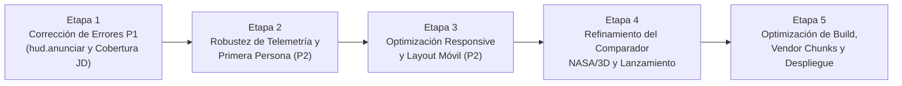

# 11. Plan Profesional de Mejoras Priorizado

**Proyecto:** Simulador de Sondas Espaciales (Sistema Solar y Misiones Voyager 1 y 2)  
**Destinatario:** Equipo de Ingeniería de Software y Agente de Desarrollo (OpenAI Codex)  
**Estrategia:** Enfoque modular quirúrgico por etapas independientes. **Prohibido reescribir módulos completos**; se aplican correcciones puntuales y verificables sobre la arquitectura existente.

---

## Hoja de Ruta General (Roadmap)



---

## Etapa 1: Corrección de Errores Críticos y Excepciones JS (P1)

### 1.1 Objetivo
Eliminar las excepciones en tiempo de ejecución registradas durante el recorrido guiado, la finalización del lanzamiento y la consulta de efemérides de la Tierra en el despegue de Voyager 2.

### 1.2 Problemas que Resuelve
- `DEF-01`: `TypeError: hud.anunciar is not a function` en `ejecutarHitoGuiado` y `alCompletarLanzamiento`.
- `DEF-02`: Excepción de cobertura temporal `outside_coverage` para la Tierra en `JD 2443376.1479166667`.

### 1.3 Archivos y Módulos Afectados
1. [src/ui/HudControls.js](file:///C:/Users/PC/simulador-sondas-espaciales/simulador-sondas-espaciales/src/ui/HudControls.js)
2. [src/science/HistoricalEphemerisResolver.js](file:///C:/Users/PC/simulador-sondas-espaciales/simulador-sondas-espaciales/src/science/HistoricalEphemerisResolver.js)
3. [src/science/EphemerisProvider.js](file:///C:/Users/PC/simulador-sondas-espaciales/simulador-sondas-espaciales/src/science/EphemerisProvider.js)

### 1.4 Cambios Concretos Recomendados
1. En `src/ui/HudControls.js`:
   Implementar la función `anunciar(mensaje)` que actualiza el texto del nodo `#hud-announcement` y exportarla en el objeto devuelto por `crearControlesHUD`:
   ```javascript
   function anunciar(mensaje) {
     if (anuncio) {
       anuncio.textContent = '';
       // Breve timeout para forzar evento aria-live en lectores de pantalla
       setTimeout(() => { anuncio.textContent = mensaje; }, 20);
     }
   }
   return { actualizarSeleccion, actualizarSeleccionSonda, anunciar };
   ```
2. En `src/science/HistoricalEphemerisResolver.js` y `src/science/EphemerisProvider.js`:
   Incorporar una constante de tolerancia numérica `const EPSILON_JD = 1e-9;` en las comprobaciones de cobertura de fechas para evitar que errores de redondeo de microsegundos rechacen muestras válidas en los límites exactos de los ficheros de datos.

### 1.5 Dependencias y Riesgos
- **Dependencias:** Ninguna.
- **Riesgo de Regresión:** Nulo.
- **Esfuerzo Estimado:** 30 minutos / 1 Story Point.

### 1.6 Criterios de Aceptación
- Ejecución de `node --test tests/*.test.mjs` sin errores (78/78 pasan).
- Navegar los 12 hitos del recorrido guiado sin registrar excepciones en la consola.
- Saltar el lanzamiento de Voyager 2 sin arrojar TypeError.

---

## Etapa 2: Robustez de Telemetría y Experiencia de Primera Persona (P2)

### 2.1 Objetivo
Garantizar que la interfaz comunique estados semánticos claros cuando las sondas estén en fechas previas a su lanzamiento, evitando guiones vacíos (`—`) y llamadas silenciosas fallidas.

### 2.2 Problemas que Resuelve
- `DEF-03`: Valores mudos de telemetría en agosto de 1977.
- `DEF-05`: Activación fallida silenciosa de Primera Persona al seleccionar una sonda no lanzada.

### 2.3 Archivos y Módulos Afectados
1. [src/ui/HistoricalModeControls.js](file:///C:/Users/PC/simulador-sondas-espaciales/simulador-sondas-espaciales/src/ui/HistoricalModeControls.js)
2. [src/main.js](file:///C:/Users/PC/simulador-sondas-espaciales/simulador-sondas-espaciales/src/main.js)

### 2.4 Cambios Concretos Recomendados
- En `HistoricalModeControls.js`, verificar el estado de la sonda (`snapshot.probes[id]?.status === 'pre_launch'`). Si está en pre-lanzamiento, sustituir los guiones por un badge explicativo: *"En plataforma de lanzamiento LC-41 · Vuelo heliocéntrico a partir del [Fecha]"*.
- En `main.js`, si el usuario intenta activar Primera Persona en una sonda en pre-lanzamiento, disparar un aviso temporal en pantalla informando que la cámara estará disponible a partir de la fecha de inyección orbital.

### 2.5 Criterios de Aceptación
- Al iniciar el Modo Histórico en 1977-08-20, la ficha de Voyager 1 muestra claramente *"Lanzamiento programado: 5 de septiembre de 1977"*.
- El botón de primera persona para Voyager 1 se deshabilita visualmente o muestra tooltip explicativo en fechas anteriores al 5 de septiembre de 1977.

---

## Etapa 3: Optimización Responsive y Layout Móvil (P2)

### 3.1 Objetivo
Mejorar la ergonomía visual y táctil en pantallas de smartphone pequeñas (320px a 480px de ancho) para que el lienzo WebGL mantenga un área libre superior al 65%.

### 3.2 Problemas que Resuelve
- `DEF-04`: Congestión vertical en viewports móviles compactos (320×568 y 390×844).

### 3.3 Archivos y Módulos Afectados
1. [src/ui/timeline-layout.css](file:///C:/Users/PC/simulador-sondas-espaciales/simulador-sondas-espaciales/src/ui/timeline-layout.css)
2. [src/ui/workspace-layout.css](file:///C:/Users/PC/simulador-sondas-espaciales/simulador-sondas-espaciales/src/ui/workspace-layout.css)

### 3.4 Cambios Concretos Recomendados
- En `timeline-layout.css`, añadir media query para `< 480px`:
  - Ocultar `.hist-date-selectors` (los 4 selects numéricos) en pantallas pequeñas; el control temporal en móvil se realiza vía el deslizador de rango continuo.
  - Reducir el padding de `.hist-transport-row` de `12px` a `6px`.
  - Reducir el tamaño de fuente de `.hist-clock-readout strong` a `0.85rem`.

### 3.5 Criterios de Aceptación
- En resolución 320×568, el lienzo 3D dispone de al menos 360 px verticales libres.
- Ningún control táctil mide menos de 40×40 px.

---

## Etapa 4: Refinamiento del Comparador NASA / 3D y Cinemática de Lanzamiento

### 4.1 Objetivo
Mejorar la fidelidad y elegancia visual del comparador fotográfico y de la secuencia cinemática de lanzamiento.

### 4.2 Cambios Concretos Recomendados
- En el comparador A/B, al abrir una fotografía, replegar automáticamente el Inspector de Contexto si está abierto, maximizando la visión del lienzo tridimensional.
- En la cinemática de lanzamiento, añadir una barra de progreso sutil en la parte inferior del overlay que indique el avance temporal (0 a 28 segundos).
- Agregar un botón de repetición (*Replay*) al finalizar la secuencia de lanzamiento.

---

## Etapa 5: Optimización de Empaquetado, Vendor Chunks y Despliegue en GitHub Pages

### 5.1 Objetivo
Eliminar la advertencia de chunk grande en Vite y preparar el despliegue automático continuo.

### 5.2 Cambios Concretos Recomendados
- En `vite.config.js`:
  ```javascript
  build: {
    rollupOptions: {
      output: {
        manualChunks: {
          three: ['three'],
          science: [
            './src/science/OrbitalDynamicsEngine.js',
            './src/science/HermiteInterpolation.js',
            './src/science/EphemerisProvider.js'
          ]
        }
      }
    }
  }
  ```
- Configurar base URL adecuada (`base: './'`) para compatibilidad universal en GitHub Pages.
- Ejecutar verificación final de compilación y pruebas de regresión.
