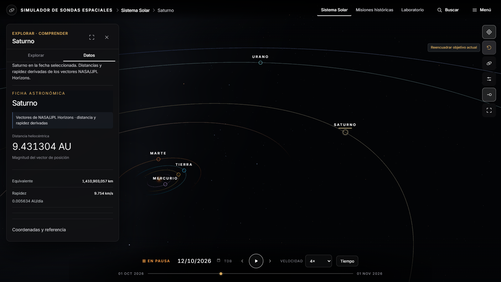
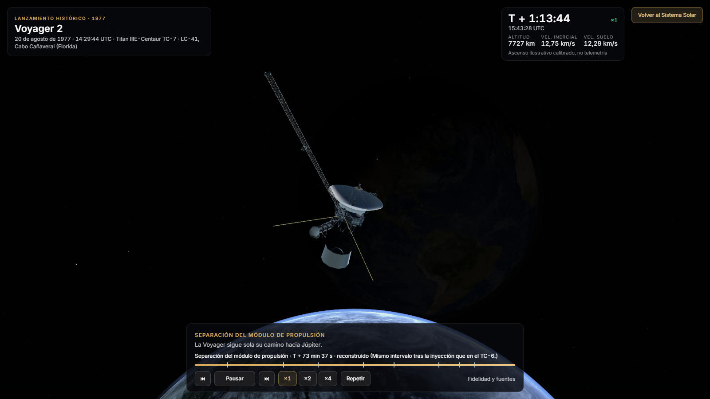
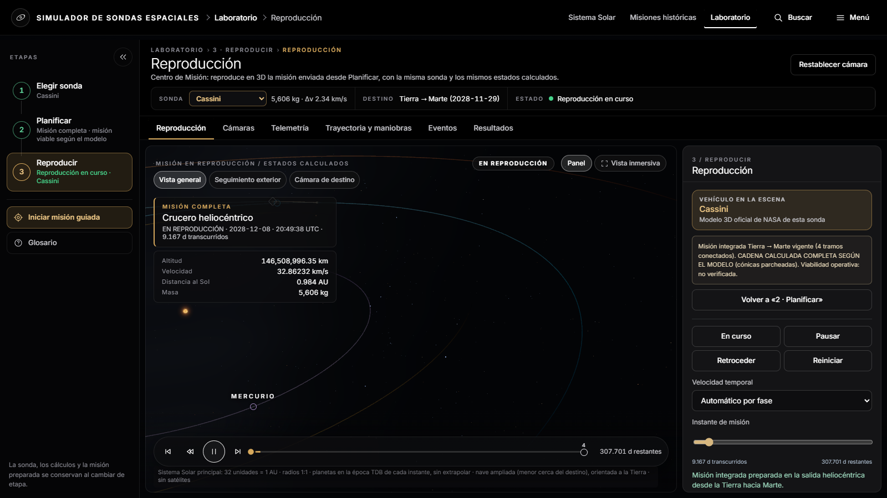

# Simulador de Sondas Espaciales

Simulador web interactivo en 3D del Sistema Solar, las misiones históricas **Voyager 1 y Voyager 2** y un **Laboratorio de Misiones** con datos reales de **NASA/JPL Horizons**, física orbital numérica y renderizado adaptativo en **WebGL 2**.

- **Demostración en línea:** <https://nata23-dev.github.io/simulador-sondas-espaciales/>
- **Repositorio:** <https://github.com/nata23-dev/simulador-sondas-espaciales>



---

## Descripción

**Simulador de Sondas Espaciales** combina graficación 3D en tiempo real con astrodinámica verificable directamente en el navegador. La arquitectura separa estrictamente la capa científica (sin dependencias gráficas ni del DOM), la capa de integración físico-visual, el motor gráfico en Three.js y la interfaz de usuario, manteniendo explícitas las unidades (`km`, `km/s`, `s`, `kg`, `N`), los marcos de referencia (`ICRF eclíptico J2000`) y las escalas de tiempo (`UTC` y `TDB`).

## Módulos principales

### 1. Sistema Solar
- Visualización 3D interactiva del Sol, los ocho planetas y diez satélites principales usando efemérides heliocéntricas y planetocéntricas reales de **NASA/JPL Horizons** (octubre de 2026) y campo estelar basado en el catálogo **Hipparcos**.
- Alternancia entre **Escala científica 1:1** (posiciones proporcionales a `32 unidades/AU`) y **Escala exploratoria**, con encuadre automático y vista cinematográfica.
- Herramienta de **medición 3D** entre cualquier par de cuerpos (distancia en `AU` y `km`, vector espacial y tiempo luz) y línea temporal interactiva.
- Perfil de **calidad gráfica adaptativa** (detección de GPU / renderizado por software, ajuste dinámico de resolución y nivel de detalle geométrico).

### 2. Misiones Históricas — Voyager 1 y Voyager 2 (1977–2026)
- Recorrido histórico completo de **Voyager 1 (`NAIF -31`)** y **Voyager 2 (`NAIF -32`)** desde 1977 hasta 2026 con efemérides reales de NASA/JPL Horizons, hitos cronológicos y cortes de kernels SPK declarados con transparencia.
- Cámara exterior e inspección **en primera persona desde Voyager** con campos visuales instrumentales (cámara estrecha `ISS-NAC 0,424°` y gran angular `WAC 3,2°`).
- **Comparador A/B** entre fotografías originales de archivo NASA/JPL y la recreación geométrica 3D en WebGL.
- Escena dedicada de **Lanzamiento 3D** desde el Complejo **LC-41** de Cabo Cañaveral con el cohete **Titan IIIE-Centaur**, separación de etapas, efectos de propulsión y despliegue de la sonda Voyager.



### 3. Laboratorio de Misiones
- **Flota histórica NASA:** selección e inspección 3D de modelos oficiales GLB (**Voyager**, **Cassini**, **Juno** y **Dawn**), fichas de ingeniería, presupuesto eléctrico y centro de masas.
- **Planificación interplanetaria:** cálculo de misiones **Tierra → planeta (→ satélite)** mediante **cónicas parcheadas** sobre efemérides reales de NASA/JPL Horizons (cobertura 2026-11-18 → 2046-01-01, sin extrapolar). Destinos: los siete planetas y los satélites galileanos de la ventana cargada.
- Incluye ventanas de lanzamiento con solucionador de **Lambert heliocéntrico**, salida desde órbita terrestre u opcionalmente desde plataforma **LC-41**, encuentro apuntado por el **plano B**, captura con empuje finito integrado con **DOPRI54** y un **crucero de n cuerpos** (ocho planetas como masas puntuales) ejecutado solo como comparación paralela.
- Los cálculos astrodinámicos pesados corren en un **Web Worker** dedicado para mantener la interfaz fluida sin bloqueos.
- **Centro de Misión:** reproducción 3D determinista directamente en la escena del Sistema Solar (misiones heliocéntricas) o en escena local (misiones geocéntricas), con cámaras de seguimiento y telemetría continua.



---

## Tecnologías utilizadas

- **JavaScript (ES Modules)** sin frameworks pesados de UI
- **Three.js (`0.186.1`)** y **WebGL 2** (con decodificación Draco para modelos 3D GLB)
- **Vite (`8.3`)** para desarrollo y empaquetado de producción con división de paquetes
- **Web Workers** para cálculos astrodinámicos intensivos fuera del hilo principal
- **HTML5 y CSS3** con diseño responsivo y soporte de teclado/accesibilidad
- **Node.js ≥ 22**, pruebas automatizadas con `node:test` (**485 pruebas**) y análisis estático con **ESLint**
- **Datos científicos reales** procedentes de **NASA/JPL Horizons**, **NASA/NAIF SPK** y **NASA 3D Resources**

---

## Instalación y ejecución local

Requisitos: **Git** y **Node.js ≥ 22** (incluye `npm`).

```bash
git clone https://github.com/nata23-dev/simulador-sondas-espaciales.git
cd simulador-sondas-espaciales
npm ci
npm run dev
```

Abre la dirección local que indique Vite en tu navegador.

### Verificación y pruebas

```bash
npm run lint        # ESLint (reglas de detección de errores)
npm test            # Ejecuta la batería completa (485 pruebas automatizadas)
npm run preview     # Previsualiza localmente la compilación de producción
```

---

## Compilación de producción y publicación

Compilación estándar (en `dist/`):

```bash
npm run build
```

Compilación con la ruta base de GitHub Pages (`/simulador-sondas-espaciales/`):

```bash
# Linux / macOS / Git Bash
GITHUB_PAGES=true npm run build

# Windows PowerShell
$env:GITHUB_PAGES='true'; npm run build
```

La publicación en **GitHub Pages** se ejecuta automáticamente mediante [`.github/workflows/deploy.yml`](.github/workflows/deploy.yml) en cada actualización de la rama `main`, mientras que [`.github/workflows/ci.yml`](.github/workflows/ci.yml) verifica ESLint, pruebas y compilación en Node 22 y 24.

---

## Base científica y limitaciones

El simulador distingue explícitamente tres niveles de fidelidad para evitar mezclar datos reales con recursos visuales:

1. **Datos astronómicos reales:** efemérides NASA/JPL Horizons en marco `ICRF eclíptico J2000` (tiempo `TDB`), conversión `UTC ↔ TAI ↔ TT ↔ TDB` con tabla IERS de segundos intercalares, e interpolación cúbica de Hermite sin extrapolación fuera de cobertura (integridad verificada mediante hashes SHA-256).
2. **Modelos físicos simplificados:** integración adaptativa Runge-Kutta **DOPRI54**, cónicas parcheadas con Lambert heliocéntrico de cero revoluciones, gravedad de masa puntual dentro de cada esfera de influencia (sin armónicos `J2` ni presión de radiación solar), atmósfera estándar US-1976 simplificada y crucero de n cuerpos solo como comparación.
3. **Representación ilustrativa:** tamaños planetarios ampliados para visibilidad, órbitas guía dibujadas, texturas cartográficas y perfil calibrado del lanzamiento 3D.

**Limitaciones declaradas:**
- **No hay** integración de n cuerpos continua de toda la misión ni asistencias gravitatorias, ni descenso atmosférico o sondas de entrada.
- Las trayectorias globales de **Voyager 1 (1981)** y **Voyager 2 (1989)** tienen cortes documentados entre kernels SPK y no se presentan como una única curva continua certificada; las vistas en primera persona usan apuntado geométrico sin kernels `CK/IK`.
- «Implementada» no significa «validada» como ingeniería de vuelo operativa: una misión «viable según el modelo» es válida dentro de las hipótesis numéricas del simulador y no sustituye software profesional de navegación espacial.
- La auditoría final de aceptación del simulador (rendimiento, pruebas científicas, funcionalidad y estabilidad) se encuentra documentada en [`docs/auditoria-final/08_DICTAMEN_FINAL.md`](docs/auditoria-final/08_DICTAMEN_FINAL.md).

---

## Documentación adicional

- [Arquitectura del software](docs/ARQUITECTURA.md) — estructura de capas, módulos, Web Workers y renderizado WebGL 2.
- [Fundamento científico y modelos](docs/FUNDAMENTO_CIENTIFICO.md) — marcos de referencia, escalas de tiempo, integradores, datos reales y límites.
- [Guía de uso](docs/GUIA_DE_USO.md) — recorrido práctico por Sistema Solar, Misiones Históricas y Laboratorio.
- [Auditoría final de aceptación](docs/auditoria-final/08_DICTAMEN_FINAL.md) — dictamen, matriz de aceptación y evidencias reproducibles.

---

## Autoría

- **Autor:** Barrera Dueñas Topilzin Natanael
- **Contexto:** Proyecto académico de la materia de **Graficación**

---

## Fuentes, créditos y condiciones de uso

No se ha declarado una licencia específica para el código fuente del proyecto. Los conjuntos de datos, modelos 3D, fotografías y texturas conservan las condiciones y créditos de sus respectivas fuentes oficiales:

- **Efemérides y kernels de referencia:** NASA / JPL Horizons y NASA / NAIF SPICE (`public/data/`, `evidence/`).
- **Modelos 3D oficiales:** NASA 3D Resources — Voyager, Cassini-Huygens, Juno y Dawn ([procedencia](public/models/nasa/README.md)).
- **Fotografías históricas y de flota:** NASA / JPL-Caltech / PDS ([archivo Voyager](public/images/fleet/README.md)).
- **Texturas planetarias, lunares y terrestres:** Solar System Scope ([créditos](public/textures/README.md)), NASA SVS / LROC / USGS Astrogeology / Cassini ([lunas](public/textures/moons/README.md)) y NASA Blue Marble / USGS ([lanzamiento LC-41](public/launch/README.md)).
- **Catálogo estelar:** ESA Hipparcos (`public/data/hipparcos-vmag-6p5.tsv`).
