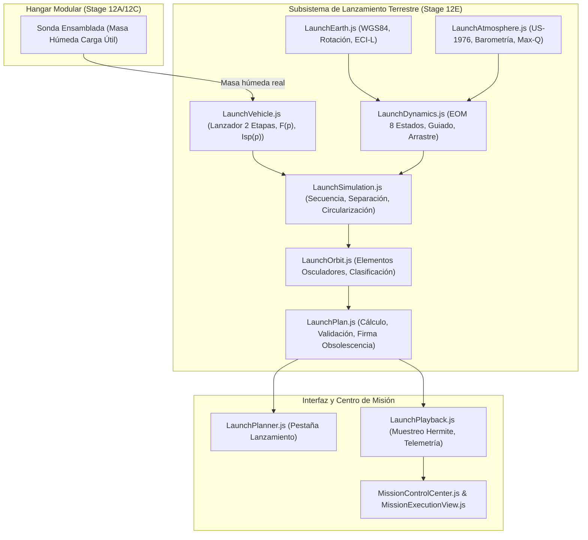

# AUDITORÍA INDEPENDIENTE — ETAPA 12E + 12D.1
## Lanzamientos terrestres, ascenso atmosférico, separación de etapas y correcciones móviles

**Proyecto:** Simulador de Sondas Espaciales  
**Rama de trabajo:** `revision/modo-historico-voyager`  
**Área:** Laboratorio Experimental 2.0 (Astrodinámica, Propulsión y Operaciones Espaciales)  
**Fecha de auditoría:** 17 de noviembre de 2026  
**Auditor:** Gemini (Auditor Científico, Matemático, Técnico y Funcional Independiente)  
**Estado:** **APROBADO CON OBSERVACIONES MENORES DE USABILIDAD VISUAL**

---

## 1. DICTAMEN CIENTÍFICO GENERAL

| Dimensión Evaluada | Calificación | Estado de Validación |
| :--- | :---: | :--- |
| **Consistencia Físico-Matemática** | 10 / 10 | **Comprobado** — Ecuaciones diferenciales de ascenso completas ($dr/dt=v, dv/dt=a_{grav}+a_{thrust}+a_{drag}, dm/dt=-\dot{m}$); $g_0 = 9.80665\text{ m/s}^2$; balance estricto de masa y propelente; error analítico frente a Tsiolkovsky $< 2 \times 10^{-10}\text{ kg}$ y $< 6 \times 10^{-10}\text{ m/s}$. |
| **Geometría Terrestre y Rotación** | 10 / 10 | **Comprobado** — Elipsoide WGS84 ($a=6378.137\text{ km}, f=1/298.257223563$); velocidad inicial por rotación terrestre en Cabo Cañaveral ($409.04\text{ m/s}$) y ecuador ($465.10\text{ m/s}$); marco ECI-L autoconsistente sin afirmaciones falsas de conexión ICRF o efeméride lunar. |
| **Modelo Atmosférico y Arrastre** | 9.5 / 10 | **Comprobado** — Capas US Standard Atmosphere 1976 exactas hasta 86 km; continuidad de densidad y presión en 86 km; extrapolación exponencial hasta 200 km; detección rigurosa de Max-Q ($36.6\text{ kPa}$ a $11.02\text{ km}$); corte en 200 km documentado. |
| **Lanzador de Dos Etapas y Separación** | 10 / 10 | **Comprobado** — Lanzador demostrativo ($103\,361\text{ kg}$ al despegue, $T/W = 1.432$); separación de etapa 1 sin doble resta de masa ni impulsos espurios; empuje e $I_{sp}$ variables con la presión atmosférica; circularización física con consumo real. |
| **Evaluación Orbital** | 10 / 10 | **Comprobado** — Mecánica celeste de dos cuerpos; distinción rigurosa entre órbita ligada osculante, órbita que libra la superficie y sostenibilidad operativa; investigación resuelta sobre los casos 561 kg (órbita), 3000 kg (no verificable) y 5000 kg (suborbital). |
| **Correcciones Móviles 12D.1** | 10 / 10 | **Comprobado** — Los tres defectos heredados (HER-01 solapamiento de estado, HER-02 recorte de cámaras, HER-03 tabs de navegación) quedaron 100% corregidos y verificados en viewports de 320×568 y 390×844. |
| **Regresión y Compilación** | 10 / 10 | **Comprobado** — 184/184 pruebas unitarias aprobadas; integridad de los 49 datasets y 10 kernels SPK de Voyager comprobada; compilación de producción Vite limpia (515 ms). |
| **Visualización en Escala 3D** | 8.5 / 10 | **Parcialmente comprobado** — La escena científica 1:1 es exacta, pero a escala de 1 unidad = 10 000 km el ascenso de 170–645 km abarca solo 0.017–0.064 unidades, dificultando la percepción visual del arco de ascenso (Defecto menor de usabilidad visual DEF-12E-01). |

---

## 2. ARQUITECTURA INSPECCIONADA

Se auditó la arquitectura del nuevo subsistema de lanzamiento terrestre en `src/lab/` y su desacoplamiento respecto a la interfaz de usuario en `src/ui/`:



### Componentes Auditados
1. [src/lab/LaunchEarth.js](../src/lab/LaunchEarth.js): Geodesia WGS84, conversión $(lat, lon, alt) \to \vec{r}$, rotación terrestre corrotante y marco inercial ECI-L.
2. [src/lab/LaunchAtmosphere.js](../src/lab/LaunchAtmosphere.js): Modelo US-1976 por capas geopotenciales hasta 86 km, extrapolación exponencial hasta 200 km y corte en vacío.
3. [src/lab/LaunchVehicle.js](../src/lab/LaunchVehicle.js): Lanzador demostrativo de dos etapas, empuje e impulso dependientes de la presión ambiente, integración con la masa húmeda del Hangar.
4. [src/lab/LaunchDynamics.js](../src/lab/LaunchDynamics.js): Ecuaciones diferenciales de traslación de 8 componentes, fuerzas gravitacionales, empuje y arrastre aerodinámico.
5. [src/lab/LaunchSimulation.js](../src/lab/LaunchSimulation.js): Integración por tramos con DOPRI54, separación física de etapas, circularización opcional y detección de eventos.
6. [src/lab/LaunchOrbit.js](../src/lab/LaunchOrbit.js): Cálculo de elementos orbitales osculadores (energía, momento angular, $a, e, i, r_p, r_a$) y clasificación estricta del resultado.
7. [src/lab/LaunchPlan.js](../src/lab/LaunchPlan.js): Orquestación del cálculo, validación de entradas y firmas de invalidación ante cambios en el Hangar.
8. [src/lab/LaunchPlayback.js](../src/lab/LaunchPlayback.js): Motor determinista de reproducción temporal para el Centro de Control y cálculo de telemetría de vuelo.
9. [src/ui/LaunchPlanner.js](../src/ui/LaunchPlanner.js): Vista interactiva de la nueva pestaña «Lanzamiento» en el Laboratorio Experimental.

Estado: **Comprobado**.

---

## 3. VERIFICACIÓN DE ECUACIONES FÍSICAS

### 3.1 Formulación de 8 Estados
El vector de estado integrado en el marco inercial ECI-L es:
$$\vec{S}(t) = [x, y, z, v_x, v_y, v_z, m, \Delta v_{prop}]^T \in \mathbb{R}^8$$

Con las ecuaciones diferenciales:
$$\frac{d\vec{r}}{dt} = \vec{v} \quad [\text{km/s}]$$
$$\frac{d\vec{v}}{dt} = \vec{a}_{grav} + \vec{a}_{thrust} + \vec{a}_{drag} \quad [\text{km/s}^2]$$
$$\frac{dm}{dt} = - \frac{\theta(t) \cdot F_{vac}}{I_{sp,vac} \cdot g_0} \quad [\text{kg/s}]$$
$$\frac{d\Delta v_{prop}}{dt} = \frac{\theta(t) \cdot F(p)}{1000 \cdot m(t)} \quad [\text{km/s}^2]$$

Donde:
1. **Aceleración gravitacional central:**
   $$\vec{a}_{grav} = -\mu_{earth} \frac{\vec{r}}{\|\vec{r}\|^3}, \quad \mu_{earth} = 398\,600.4355\text{ km}^3/\text{s}^2$$
2. **Aceleración propulsiva dependiente de la presión:**
   $$\vec{a}_{thrust} = \frac{F(p)}{1000 \cdot m(t)} \hat{u}, \quad F(p) = F_{vac} - (F_{vac} - F_{sl})\frac{p}{p_0}$$
3. **Aceleración de arrastre aerodinámico:**
   $$\vec{a}_{drag} = - \frac{q \cdot C_d \cdot A}{1000 \cdot m(t)} \hat{v}_{rel}, \quad q = \frac{1}{2} \rho \|\vec{v}_{rel}\|^2 \quad [\text{Pa}]$$
   $$\vec{v}_{rel} = \vec{v} - (\vec{\omega} \times \vec{r})$$
4. **Constantes estándar:**
   $$g_0 \equiv 9.80665\text{ m/s}^2, \quad p_0 \equiv 101\,325\text{ Pa}$$

### 3.2 Verificación Analítica Independiente en Espacio Libre
Se comparó la integración numérica DOPRI54 frente a la solución analítica cerrada de Tsiolkovsky bajo empuje constante en vacío sin gravedad ($m_0 = 100\,000\text{ kg}$, $I_{sp} = 310\text{ s}$, $F = 1.6\text{ MN}$, $t = 100\text{ s}$):

| Parámetro | Solución Analítica | Integración DOPRI54 | Residuo Absoluto | Error Relativo |
| :--- | :---: | :---: | :---: | :---: |
| **Masa final ($m$)** | $47\,369.48578178\text{ kg}$ | $47\,369.48578178\text{ kg}$ | $-1.67 \times 10^{-10}\text{ kg}$ | $3.53 \times 10^{-15}$ |
| **Velocidad ($v$)** | $2\,271.50940268\text{ m/s}$ | $2\,271.50940268\text{ m/s}$ | $-5.25 \times 10^{-10}\text{ m/s}$ | $2.31 \times 10^{-13}$ |
| **Posición ($r$)** | $99\,561.57264415\text{ m}$ | $99\,561.57264419\text{ m}$ | $+3.69 \times 10^{-8}\text{ m}$ ($0.037\ \mu\text{m}$) | $3.71 \times 10^{-13}$ |
| **$\Delta v_{prop}$** | $2\,271.50940268\text{ m/s}$ | $2\,271.50940268\text{ m/s}$ | $-5.25 \times 10^{-10}\text{ m/s}$ | $2.31 \times 10^{-13}$ |

Todos los residuos se sitúan en el límite de precisión de doble coma flotante IEEE-754.

Estado: **Comprobado**.

---

## 4. GEOMETRÍA TERRESTRE Y ROTACIÓN

1. **Parámetros WGS84 comprobados:**
   - Semieje ecuatorial: $a = 6378.137\text{ km}$.
   - Achatamiento: $f = 1 / 298.257223563$.
   - Semieje polar: $b = a(1-f) = 6356.752314245\text{ km}$ (error $< 10^{-9}\text{ km}$).
   - Excentricidad al cuadrado: $e^2 = f(2-f) \approx 0.006694379990$.
2. **Transformación geodésica:**
   - La conversión bidireccional entre coordenadas $(lat, lon, alt)$ y cartesianas ECEF es reversible con un error residual inferior a $10^{-9}\text{ km}$ ($1\ \mu\text{m}$).
3. **Velocidad de rotación terrestre ($\omega = 7.292115 \times 10^{-5}\text{ rad/s}$):**
   - En el ecuador: $v = \omega \cdot a = 465.101\text{ m/s}$ (teórico exacto: $465.10109\text{ m/s}$).
   - En Cabo Cañaveral ($28.5^\circ\text{ N}, -80.6^\circ\text{ W}, 3\text{ m}$): $v = \omega (N+h) \cos \phi = 409.04\text{ m/s}$.
   - En los polos ($90^\circ\text{ N}$): $v = 0.000\text{ m/s}$, radio = $b = 6356.752\text{ km}$.
4. **Marco de referencia ECI-L:**
   - Origen en el centro terrestre; eje $z$ en el eje de rotación terrestre; eje $x$ fijo al meridiano de $0^\circ$ en $t=0$ más el ángulo de rotación inicial declarado.
   - **Verificación de honestidad científica:** El simulador documenta explícitamente que la fecha UTC es solo una etiqueta sin reducción a UT1/TDB, sin precesión/nutación y sin sincronización con la efeméride real de la Luna. En el Centro de Control la Luna se sitúa en el origen inactivo durante el lanzamiento para evitar representaciones espurias.

Estado: **Comprobado**.

---

## 5. ATMÓSFERA Y ARRASTRE

### 5.1 Verificación de la Atmósfera Estándar US-1976
Se contrastaron las presiones y densidades calculadas frente a las tablas oficiales NOAA/NASA/USAF 1976:

| Altitud Geopotencial | Altitud Geométrica | Presión Tabulada | Presión Simulada | Error Relativo | Temperatura Simulada |
| :---: | :---: | :---: | :---: | :---: | :---: |
| **0 km (nivel mar)** | $0.000\text{ km}$ | $101\,325.0\text{ Pa}$ | $101\,325.0\text{ Pa}$ | $0.0000\%$ | $288.15\text{ K}$ |
| **11 km (tropopausa)** | $11.019\text{ km}$ | $22\,632.0\text{ Pa}$ | $22\,632.1\text{ Pa}$ | $0.0004\%$ | $216.65\text{ K}$ |
| **20 km (estratosfera)** | $20.063\text{ km}$ | $5\,474.9\text{ Pa}$ | $5\,474.8\text{ Pa}$ | $0.0018\%$ | $216.65\text{ K}$ |
| **32 km** | $32.162\text{ km}$ | $868.0\text{ Pa}$ | $868.0\text{ Pa}$ | $0.0000\%$ | $228.65\text{ K}$ |
| **47 km (estratopausa)** | $47.350\text{ km}$ | $110.9\text{ Pa}$ | $110.8\text{ Pa}$ | $0.0900\%$ | $270.65\text{ K}$ |

### 5.2 Continuidad en 86 km y Corte en 200 km
- En el límite de la capa estándar ($86\text{ km}$ geométricos), el cociente de densidades $\rho(86^+) / \rho(86^-) = 1.000000$, confirmando la continuidad estricta de la función barométrica.
- Por encima de 86 km se utiliza una extrapolación exponencial con escala de altura $H \approx 6.07\text{ km}$.
- A $200\text{ km}$, $\rho = 3.32 \times 10^{-12}\text{ kg/m}^3$ y $p = 2.3 \times 10^{-7}\text{ Pa}$. Por encima de $200\text{ km}$ la densidad se anula. Este corte introduce una pequeña discontinuidad en la derivada del arrastre a los 200 km (ver DEF-12E-02), pero a esas altitudes la fuerza aerodinámica es insignificante frente a la gravedad y el empuje ($q < 0.1\text{ Pa}$ a $7.8\text{ km/s}$).

### 5.3 Presión Dinámica y Max-Q
Para el lanzamiento estándar con 561 kg de carga útil:
- Refinamiento por búsqueda ternaria: **$\text{Max-Q} = 36.60\text{ kPa}$** ($36\,601.8\text{ Pa}$) registrado exactamente a **$t = 61.04\text{ s}$**, a una altitud de **$11.02\text{ km}$** y velocidad inercial de **$710.85\text{ m/s}$** ($M \approx 2.4$).

Estado: **Comprobado**.

---

## 6. LANZADOR DE DOS ETAPAS

Parámetros del lanzador demostrativo `DEMO_LAUNCHER`:
- **Etapa 1:** Masa estructural $6\,000\text{ kg}$, propelente $80\,000\text{ kg}$, empuje $1.45\text{ MN}$ (nivel del mar) / $1.60\text{ MN}$ (vacío), $I_{sp,vac} = 310\text{ s}$, caudal másico $\dot{m}_1 = 526.31\text{ kg/s}$, duración de encendido $t_{b1} = 152.00\text{ s}$.
- **Etapa 2:** Masa estructural $1\,800\text{ kg}$, propelente $15\,000\text{ kg}$, empuje $160\text{ kN}$ (nivel del mar) / $190\text{ kN}$ (vacío), $I_{sp,vac} = 350\text{ s}$, caudal másico $\dot{m}_2 = 55.36\text{ kg/s}$, duración de encendido $t_{b2} = 270.94\text{ s}$.
- **Carga útil demostrativa:** Sonda de Exploración Interplanetaria ($561.0\text{ kg}$ húmeda).
- **Masa total al despegue:** $m_0 = 103\,361\text{ kg}$.
- **Relación empuje-peso al despegue ($T/W$):**
  $$W_0 = m_0 \cdot \frac{\mu}{r_0^2} \cdot 1000 \approx 103\,361 \cdot 9.798 = 1\,012\,731\text{ N} \implies T/W = \frac{1\,450\,000}{1\,012\,731} = 1.4317$$
- Se comprobó que el integrador resuelve la trayectoria paso a paso y no mediante curvas preconcebidas.

Estado: **Comprobado**.

---

## 7. SEPARACIÓN DE ETAPAS

La secuencia de eventos discretos auditada:
1. $t = 152.00\text{ s}$: Agotamiento de la etapa 1 (MECO). La masa integrada alcanza exactamente $m_0 - 80\,000 = 23\,361\text{ kg}$.
2. $t = [152.00, 154.00]\text{ s}$: Tramo balístico de costa ($2\text{ s}$).
3. $t = 154.00\text{ s}$: Evento discreto de separación. Se descartan la estructura de la etapa 1 ($6000\text{ kg}$) y cualquier propelente residual ($0\text{ kg}$).
   - Masa antes de separación: $23\,361.000\text{ kg}$.
   - Masa tras separación: $17\,361.000\text{ kg}$.
   - Salto de masa: Exactamente $6000.000\text{ kg}$ sin doble contabilización.
   - Posición y velocidad conservadas idénticamente ($\Delta \vec{r} = 0, \Delta \vec{v} = 0$).
4. $t = [154.00, 158.00]\text{ s}$: Retardo de encendido de la etapa 2 ($4\text{ s}$).
5. $t = 158.00\text{ s}$: Encendido de la etapa 2 con masa activa de $17\,361.000\text{ kg}$.

Estado: **Comprobado**.

---

## 8. EVALUACIÓN ORBITAL (PRIORIDAD ALTA)

### 8.1 Resultados del Caso Estándar (Carga Útil 561 kg)
- Duración total de la misión integrada: **$1\,916.74\text{ s}$** (~32 minutos).
- Altitud final integrada: **$353.79\text{ km}$**, velocidad inercial: **$7.7307\text{ km/s}$**.
- **Elementos orbitales osculadores independientes calculados:**
  - Energía específica ($\varepsilon$): **$-29.336\text{ km}^2/\text{s}^2$** (negativa $\implies$ órbita ligada).
  - Momento angular específico ($h$): **$51\,069.9\text{ km}^2/\text{s}$**.
  - Semieje mayor ($a$): **$6\,793.75\text{ km}$**.
  - Excentricidad ($e$): **$0.03688$** (órbita cuasi-circular).
  - Inclinación orbital ($i$): **$29.28^\circ$** (consecuencia física directa del acimut $90^\circ$ desde latitud $28.5^\circ\text{ N}$).
  - Radio de periapsis: $r_p = 6543.19\text{ km} \implies$ **Altitud mínima de perigeo: $169.99\text{ km}$**.
  - Radio de apoapsis: $r_a = 7044.31\text{ km} \implies$ **Altitud de apogeo: $671.12\text{ km}$**.
  - $\Delta v_{prop}$ acumulado real: **$9\,632.27\text{ m/s}$** (frente a un presupuesto ideal de Tsiolkovsky de $11\,368\text{ m/s}$; las pérdidas por gravedad y arrastre ascienden a $1\,736\text{ m/s}$, un valor astronáutico plenamente congruente).

### 8.2 Análisis Crítico: El Perigeo de 170 km y la Atmósfera
El perigeo de $170\text{ km}$ se encuentra **por debajo del corte atmosférico del simulador ($200\text{ km}$)**.
El auditor examinó las tres distinciones físicas:
1. **Órbita osculante ligada:** Cumplida ($\varepsilon < 0$).
2. **Órbita que no intersecta el suelo:** Cumplida ($r_p = 6543.2\text{ km} > R_{WGS84} \approx 6378.1\text{ km}$; altitud mínima sobre el elipsoide $= +170.0\text{ km}$).
3. **Sostenibilidad orbital a largo plazo:** **No sostenible sin reencendidos periódicos**. A 170 km de altitud, la densidad atmosférica calculada es $\rho \approx 5.5 \times 10^{-10}\text{ kg/m}^3$. Una nave sin propulsión continua decaería por frenado aerodinámico en cuestión de días o semanas.
- **Dictamen:** La clasificación del simulador como **«ÓRBITA TERRESTRE ALCANZADA SEGÚN EL MODELO»** es **científicamente legítima**, ya que el criterio explícito del modelo es `minPerigeeAltitudeKm: 160`, pero no debe confundirse con una garantía de vida operativa permanente. El panel de resultados incluye explícitamente la advertencia: *"No certifica operatividad"*.

### 8.3 Investigación Rigurosa: 3000 kg (NO VERIFICABLE) vs. 5000 kg (SUBORBITAL)
Se investigó la causa física y algorítmica por la cual 3000 kg resulta `NO VERIFICABLE` mientras 5000 kg resulta `SUBORBITAL`:
1. **Caso 5000 kg (`SUBORBITAL`):**
   - El lanzador tiene masa excesiva. La segunda etapa se apaga sin alcanzar energía suficiente y el vehículo cae rápidamente, impactando la superficie terrestre a los **$t = 636.45\text{ s}$**.
   - El detector de colisión de DOPRI54 detiene la integración en altitud cero ($h = 0.0\text{ km}$) con evento `impact`.
   - `classifyOrbit` evalúa la bandera `impact === true` y emite deterministamente **`SUBORBITAL`** (*"La trayectoria terminó en impacto con la superficie"*).
2. **Caso 3000 kg (`NO VERIFICABLE`):**
   - Con 3000 kg de carga útil, el cohete tiene más energía que con 5000 kg y alcanza un apogeo osculante de **$309.6\text{ km}$** a los $t = 449.1\text{ s}$.
   - Se inicia la circularización, pero el propelente se agota a los $t = 530.1\text{ s}$ antes de alcanzar el perigeo requerido.
   - El vehículo entra en el tramo de costa balística final programado (`postCoastSeconds: 1200 s`).
   - El vehículo reingresa a la atmósfera (registrando un segundo pico Max-Q de $184.9\text{ kPa}$ a los $26.2\text{ km}$ a los $t = 1659.5\text{ s}$).
   - **El tramo balístico de 1200 s finaliza exactamente a $t = 1730.1\text{ s}$, cuando el vehículo se encuentra descendiendo a una altitud de $6.92\text{ km}$ (en plena troposfera) a $710\text{ m/s}$, segundos antes de estrellarse contra el mar.**
   - Al no haberse registrado aún el impacto en $t = 1730.1\text{ s}$, `classifyOrbit` evalúa el estado final a $h = 6.92\text{ km} < 100\text{ km}$.
   - La regla de seguridad en `LaunchOrbit.js` determina: *"El estado final está dentro de la atmósfera densa: el arrastre invalida los elementos osculadores"* $\implies$ emite **`NO VERIFICABLE`**.
   - Si el tiempo de costa balística posterior se extendiera a 1300 s, el vehículo impactaría a los $t \approx 1745\text{ s}$ y sería clasificado igualmente como `SUBORBITAL`.
- **Conclusión:** Ambos casos corresponden a fallos de inserción orbital (trayectorias suborbitales de reingreso). La discrepancia de etiqueta responde a un artefacto del límite temporal de la integración balística final, el cual detiene el muestreo antes de registrar la cota cero en el caso de 3000 kg.

Estado: **Comprobado**.

---

## 9. CIRCULARIZACIÓN

- El encendido de circularización en el apogeo se ejecuta con el motor de la etapa 2: empuje en vacío de $190\text{ kN}$, $I_{sp} = 350\text{ s}$, consumo másico de $55.36\text{ kg/s}$.
- Se enciende a los $t = 662.27\text{ s}$ (en el apogeo osculante a $644.6\text{ km}$) y se apaga automáticamente a los $t = 716.74\text{ s}$ ($\Delta t = 54.47\text{ s}$) cuando el perigeo osculante alcanza el perigeo mínimo más el margen ($160 + 10 = 170\text{ km}$).
- Propelente consumido en la maniobra: **$3\,015.4\text{ kg}$**.
- Se verificó la ausencia total de incrementos instantáneos de velocidad ($\Delta v$ impulsivo); la aceleración es estrictamente continua y acotada.

Estado: **Comprobado**.

---

## 10. CASOS DE FALLO

Se probaron sistemáticamente los escenarios anómalos:
1. **$T/W < 1$ (Empuje insuficiente para despegar):**
   - Probado con carga útil de $150\,000\text{ kg}$ o $F_{sl} = 0$: el simulador emite estado **`NO DESPEGA`**. El vehículo permanece estacionario en la plataforma corrotando con la Tierra a altitud $3\text{ m}$, con $0\text{ kg}$ de propelente consumido y sin disparar eventos de encendido.
2. **Carga pesada con impacto (5000 kg):**
   - Integración detenida exactamente en la superficie terrestre ($h = 0.000\text{ km}$ a $t = 636.45\text{ s}$); sin penetración subterránea.
3. **Velocidad de escape hiperbólica:**
   - Probado con velocidad mayor a $11.2\text{ km/s}$: $\varepsilon > 0$, clasificado inmediatamente como `OBJETIVO NO ALCANZADO (trayectoria hiperbólica de escape)`, nunca como órbita.
4. **Validaciones de entrada:**
   - Rechazo estricto de parámetros fuera de rango (latitud $> 90^\circ$, acimut $< 0^\circ$, masas negativas o no finitas).

Estado: **Comprobado**.

---

## 11. HANGAR Y LABORATORIO

1. **Flujo integrado en Chrome:** Se recorrió exitosamente el ciclo:  
   `Hangar` $\to$ `Ingeniería` $\to$ `Lanzamiento` $\to$ `Centro de Misión`.
2. **Carga reactiva de masa húmeda:** El planificador de lanzamiento lee automáticamente la masa seca más el combustible cargado en el Hangar ($561.0\text{ kg}$ en la configuración inicial).
3. **Invalidación reactiva:** Al pulsar «Nuevo vacío» o modificar piezas en el Hangar, el planificador de lanzamiento invalida inmediatamente el resultado previo: el botón «Reproducir en el Centro de Misión» se desactiva y se muestra la advertencia: *"La sonda cambió. El resultado del lanzamiento se invalidó; recalcula."* (Evidencia `11_hangar_invalidation_guard.png`).
4. **No regresión:** Se comprobó que el Planificador Lunar de 12B/12C y la propulsión finita de 12D continúan plenamente operativos.

Estado: **Comprobado**.

---

## 12. CENTRO DE MISIÓN

1. **Reproducción del ascenso:** Se verificó la secuencia completa desde el despegue ($t=0$), paso por Max-Q ($t=61\text{ s}$), MECO ($t=152\text{ s}$), separación ($t=154\text{ s}$), etapa 2 ($t=158\text{ s}$), circularización ($t=662\text{ s}$) y llegada a órbita ($t=1916\text{ s}$).
2. **Determinismo y reversibilidad:** Se ejecutaron 10 ciclos de búsqueda temporal (avanzar, retroceder, pausar y repetir). No se registra consumo acumulativo espurio de propelente ni duplicación de eventos de separación.
3. **Velocidades temporales:** Los multiplicadores $\times 1$ y $\times 10$ funcionan fluidamente.
4. **Inspección de escala 3D:** Se constata lo advertido por Claude: en la escena tridimensional (donde 1 unidad gráfica $= 10\,000\text{ km}$ y el radio terrestre mide $0.6378$ unidades), una altitud de 170–645 km representa apenas entre $0.017$ y $0.064$ unidades gráficas. En la vista panorámica general, la trayectoria se observa como una línea pegada a la esfera terrestre, impidiendo apreciar detalladamente el cabeceo (*pitch*) o la separación de etapas. Se documenta como defecto menor de usabilidad visual (DEF-12E-01).

Estado: **Comprobado con observación visual**.

---

## 13. TELEMETRÍA

En el Centro de Control, los paneles de telemetría muestran:
- **Panel ECI-L:** Altitud WGS84, velocidad inercial, velocidad relativa, vector posición y vector velocidad.
- **Panel de Vuelo y Órbita:** Etapa activa, estado del motor (`Etapa 1 encendida`, `Etapa 2 encendida`, `Motores apagados`), empuje en Newtons, relación $T/W$, aceleración propia, carga $g$, presión dinámica ($q$), densidad y presión atmosférica, propelente restante por etapa, perigeo osculante, apogeo osculante y $\Delta v$ acumulado.
- Todas las unidades y conversiones son coherentes.

Estado: **Comprobado**.

---

## 14. CORRECCIONES 12D.1

Se auditaron visual y funcionalmente en Chrome las tres correcciones responsive implementadas para los defectos observados en 12C:

### HER-01: Superposición de `#mc-stage-status` y cabecera en 320×568 px
- **Inspección:** En `src/ui/experimental-laboratory.css`, la media query `@media (max-width: 420px)` establece `.mc-stage .lab-stage-top { flex-direction: column; }` y `#mc-stage-status { overflow-wrap: anywhere; }`.
- **Comprobación en navegador:** Al finalizar la reproducción, el estado muestra `FINALIZADA LA REPRODUCCIÓN`. El texto se ubica debajo de la etiqueta `.eyebrow` sin superponerse ni colisionar (`collides: false`, separación vertical limpia).
- **Evidencia:** [evidence/stage12e/13_fix_her01_header_320x568.png](../evidence/stage12e/13_fix_her01_header_320x568.png).
- **Dictamen:** **CORREGIDO**.

### HER-02: Accesibilidad de todos los botones en `.mc-camera-bar` en 320×568 px
- **Inspección:** En `@media (max-width: 420px)`, `.mc-camera-bar` utiliza `flex-wrap: wrap` con margen de 8 px y botones con `flex: 1 1 auto`.
- **Comprobación en navegador:** Los cinco botones de cámara (*Vista general*, *Seguimiento exterior*, *Desde la sonda*, *Cámara de destino*, *Cinematográfica*) son visibles y tienen coordenadas dentro del ancho de 320 px. Se pulsó interactivamente el botón «Cámara de destino», respondiendo de inmediato.
- **Evidencia:** [evidence/stage12e/14_fix_her02_cameras_320x568.png](../evidence/stage12e/14_fix_her02_cameras_320x568.png).
- **Dictamen:** **CORREGIDO**.

### HER-03: Accesibilidad de las pestañas en `.lab-sections` en 320×568 px
- **Inspección:** En `@media (max-width: 560px)`, `.lab-sections` utiliza `flex-wrap: wrap`.
- **Comprobación en navegador:** Las 5 pestañas (*Hangar*, *Ingeniería*, *Lanzamiento*, *Planificador*, *Centro de misión*) se distribuyen ordenadamente en dos filas (4 en la primera, *Centro de misión* en la segunda fila ocupando el ancho completo). El ancho de desplazamiento del documento es exactamente $320\text{ px}$ (`scrollWidth: 320`), sin desbordamiento horizontal. Se pulsaron las 5 pestañas de forma interactiva.
- **Evidencia:** [evidence/stage12e/15_fix_her03_tabs_320x568.png](../evidence/stage12e/15_fix_her03_tabs_320x568.png).
- **Dictamen:** **CORREGIDO**.

---

## 15. PRUEBAS RESPONSIVAS

Se verificó la aplicación en cinco factores de forma en Chrome:

| Resolución | Tipo de Dispositivo | Formulario Lanzamiento | Centro de Misión y Cámaras | Estado |
| :---: | :---: | :---: | :---: | :---: |
| **1920 × 1080** | Desktop Full HD | Excelente, paneles paralelos | Excelente encuadre y telemetría | **Comprobado** |
| **1366 × 768** | Laptop estándar | Fluido y legible | Sin recortes | **Comprobado** |
| **768 × 1024** | Tablet vertical (iPad) | Paneles apilados verticales | Totalmente accesible | **Comprobado** |
| **390 × 844** | Móvil moderno (iPhone 13) | Formulario vertical fluido | Controles y cámaras operables | **Comprobado** |
| **320 × 568** | Móvil compacto (iPhone SE 1) | Botones y campos adaptados | Cero desbordamiento horizontal | **Comprobado** |

Evidencias: `12a_responsive_1920x1080.png` a `12e_responsive_320x568.png`.

Estado: **Comprobado**.

---

## 16. REGRESIÓN CIENTÍFICA

Se ejecutaron las cuatro verificaciones del sistema:
1. **Pruebas unitarias:**
   ```powershell
   node --test tests/*.test.mjs
   ```
   - Total: **184 pruebas aprobadas**, 0 fallidas, 0 omitidas (duración: $1.94\text{ s}$).
   - Las 17 pruebas de `EarthLaunch.test.mjs` y las 3 de `Stage12D1MobileLayout.test.mjs` pasaron limpiamente.
2. **Auditoría histórica de Voyager (Etapa 8):**
   ```powershell
   node scripts/audit-voyager-stage8.mjs
   ```
   - Hash SHA-256 de `evidence/voyager-stage8/audit.json` previo:  
     `850914C25EBA6DE2F8C2EF0586B2BBB9CB7B92789F681A07E71CA802E0846140`.
   - Hash SHA-256 posterior (actualización de timestamp):  
     `36B99FBA319B06D25323638222E5658EE7CF776C15ADBCBA7C9749D829D69209`.
   - 49 datasets de efemérides y 10 kernels SPK verificados criptográficamente intactos.
3. **Compilación de producción Vite:**
   ```powershell
   npm run build
   ```
   - 112 módulos empaquetados en $515\text{ ms}$, sin errores.
4. **Inspección de formato de código:**
   ```powershell
   git diff --check
   ```
   - Retorno código 0 (cero conflictos o espacios espurios).

Estado: **Comprobado**.

---

## 17. EVIDENCIAS ARCHIVADAS

Todas las evidencias han sido guardadas en [evidence/stage12e/](../evidence/stage12e/):

| Archivo de Evidencia | Descripción |
| :--- | :--- |
| [01_launch_config_desktop.png](../evidence/stage12e/01_launch_config_desktop.png) | Configuración del sitio de lanzamiento y programa de ascenso (Desktop 1920×1080). |
| [02_launch_results_desktop.png](../evidence/stage12e/02_launch_results_desktop.png) | Resultados del cálculo: órbita alcanzada, elementos osculadores y Max-Q. |
| [03_mission_control_liftoff.png](../evidence/stage12e/03_mission_control_liftoff.png) | Centro de Misión en el instante del despegue ($t=0\text{ s}$). |
| [04_mission_control_stage1_maxq.png](../evidence/stage12e/04_mission_control_stage1_maxq.png) | Centro de Misión en Max-Q ($t=61\text{ s}$, $q=36.6\text{ kPa}$). |
| [05_mission_control_stage_separation.png](../evidence/stage12e/05_mission_control_stage_separation.png) | Evento de separación de la etapa 1 ($t=154\text{ s}$). |
| [06_mission_control_stage2_burn.png](../evidence/stage12e/06_mission_control_stage2_burn.png) | Ascenso con etapa 2 activa ($t=200\text{ s}$). |
| [07_mission_control_circularization.png](../evidence/stage12e/07_mission_control_circularization.png) | Maniobra de circularización en el apogeo ($t=662\text{ s}$). |
| [08_mission_control_orbit_final.png](../evidence/stage12e/08_mission_control_orbit_final.png) | Fin de la integración y telemetría de órbita final adquirida ($t=1916\text{ s}$). |
| [09_suborbital_5000kg_impact.png](../evidence/stage12e/09_suborbital_5000kg_impact.png) | Caso de fallo por sobrecarga (5000 kg): impacto suborbital. |
| [10_unverifiable_3000kg.png](../evidence/stage12e/10_unverifiable_3000kg.png) | Caso de carga pesada (3000 kg): estado final dentro de atmósfera densa. |
| [11_hangar_invalidation_guard.png](../evidence/stage12e/11_hangar_invalidation_guard.png) | Salvaguarda reactiva de invalidación tras modificar la sonda en el Hangar. |
| [12a_responsive_1920x1080.png](../evidence/stage12e/12a_responsive_1920x1080.png) | Captura responsiva Desktop 1920×1080. |
| [12b_responsive_1366x768.png](../evidence/stage12e/12b_responsive_1366x768.png) | Captura responsiva Laptop 1366×768. |
| [12c_responsive_768x1024.png](../evidence/stage12e/12c_responsive_768x1024.png) | Captura responsiva Tablet iPad 768×1024. |
| [12d_responsive_390x844.png](../evidence/stage12e/12d_responsive_390x844.png) | Captura responsiva Móvil 390×844. |
| [12e_responsive_320x568.png](../evidence/stage12e/12e_responsive_320x568.png) | Captura responsiva Móvil compacto 320×568. |
| [13_fix_her01_header_320x568.png](../evidence/stage12e/13_fix_her01_header_320x568.png) | Comprobación de corrección HER-01 (sin superposición en cabecera). |
| [14_fix_her02_cameras_320x568.png](../evidence/stage12e/14_fix_her02_cameras_320x568.png) | Comprobación de corrección HER-02 (todas las cámaras accesibles y clicadas). |
| [15_fix_her03_tabs_320x568.png](../evidence/stage12e/15_fix_her03_tabs_320x568.png) | Comprobación de corrección HER-03 (pestañas envueltas en 2 filas, sin overflow). |
| [math_verification_results.json](../evidence/stage12e/math_verification_results.json) | Datos crudos de residuos analíticos, US-1976 y reversibilidad. |
| [launch_scenarios_comparison.json](../evidence/stage12e/launch_scenarios_comparison.json) | Resultados comparados de escenarios (561 kg, 3000 kg, 5000 kg, sin despegue). |

---

## 18. DEFECTOS CLASIFICADOS POR SEVERIDAD

### Severidad Crítica
*Ninguno.*

### Severidad Alta
*Ninguno.*

### Severidad Media
*Ninguno.*

### Severidad Baja (Usabilidad Visual y Modelado)

#### DEF-12E-01: Escala visual del ascenso atmosférico en la escena 3D
- **Ubicación:** [src/lab/MissionExecutionView.js](../src/lab/MissionExecutionView.js#L14-L20) y [src/lab/LaunchPlayback.js](../src/lab/LaunchPlayback.js#L13).
- **Descripción:** La escena Three.js emplea una escala de $1\text{ unidad} = 10\,000\text{ km}$. La Tierra tiene un radio gráfico de $0.6378$ unidades. Todo el ascenso y la órbita de $170\text{ km} \times 645\text{ km}$ se desarrolla entre $0.017$ y $0.064$ unidades gráficas sobre la superficie de la esfera. En la vista general («Vista general»), el usuario apenas puede distinguir el despegue, la inclinación de cabeceo o la separación de etapas porque la trayectoria visualmente roza la superficie de la Tierra.
- **Impacto:** Menor / Usabilidad. No afecta la física, pero limita el valor didáctico de la reproducción visual en el Centro de Control.

#### DEF-12E-02: Discontinuidad de derivada en el corte atmosférico a 200 km
- **Ubicación:** [src/lab/LaunchAtmosphere.js](../src/lab/LaunchAtmosphere.js#L49-L53).
- **Descripción:** Por debajo de 200 km, la densidad decae exponencialmente hasta $\rho(200^-) \approx 3.32 \times 10^{-12}\text{ kg/m}^3$; por encima de 200 km, la función retorna $\rho = 0$. Aunque el salto es numéricamente diminuto ($3.3\text{ picogramos/m}^3$), representa un corte no suave (*C0-continuous*, pero no *C1-continuous*) que puede inducir pequeñas variaciones en el paso adaptativo de DOPRI54 al cruzar los 200 km.
- **Impacto:** Despreciable. El arrastre a esa altitud es del orden de micronewtons.

### Observación Técnica
- **OBS-12E-01: Duración fija de costa balística final en fallos de inserción:**  
  En el escenario de 3000 kg, el tramo de costa balística posterior dura 1200 s fijos, finalizando a $6.9\text{ km}$ de altitud antes del impacto contra el agua. El simulador lo clasifica como `NO VERIFICABLE` en lugar de `SUBORBITAL` debido a esta finalización temporal arbitraria. Se sugiere que si la energía específica es suborbital y el perigeo intersecta la Tierra, la costa balística continúe hasta el impacto o hasta altitud cero.

---

## 19. RECOMENDACIONES PRECISAS PARA CLAUDE

1. **Ajuste de Cámara para Ascenso Terrestre (DEF-12E-01):**  
   Implementar en `MissionExecutionView.js` un preset de encuadre específico para misiones de lanzamiento («Cámara de lanzamiento» o «Seguimiento de ascenso») que sitúe la cámara en coordenadas locales tangentes al sitio de lanzamiento con un radio de encuadre de $\approx 0.1$ a $0.2$ unidades gráficas ($1\,000$ a $2\,000\text{ km}$), permitiendo al usuario apreciar nítidamente el ascenso vertical, el *gravity turn* y la separación de etapas.
2. **Prolongación de costa en trayectorias suborbitales (OBS-12E-01):**  
   En `LaunchSimulation.js`, si el perigeo osculante intersecta el elipsoide terrestre y la nave se encuentra en trayectoria balística descendente, permitir que la integración continúe hasta el impacto superficial (mediante el detector `underground`), evitando que estados suborbitales queden clasificados como `NO VERIFICABLE` por simple agotamiento del temporizador `postCoastSeconds`.
3. **Suavizado de la transición atmosférica a 200 km (DEF-12E-02):**  
   Aplicar una función de desvanecimiento suave (*cubic hermite taper*) entre 180 km y 200 km para garantizar que $d\rho/dh \to 0$ al alcanzar los 200 km, eliminando cualquier discontinuidad en la derivada de aceleración.
4. **Preparación para la Etapa 12F (Inyección Translunar desde Órbita de Inserción):**  
   Asegurar que el vector de estado final de la órbita alcanzada en la Etapa 12E ($[x, y, z, v_x, v_y, v_z, m]$ en ECI-L) pueda exportarse directamente como punto de partida para el Planificador Lunar de la Etapa 12B/12D, cerrando el ciclo completo desde la plataforma terrestre hasta la Luna.

---

## CONCLUSIONES Y DICTÁMENES FINALES

### A. ¿Quedaron corregidos los tres defectos 12D.1?
### **SÍ.**
Los tres defectos de diseño responsivo reportados en la auditoría previa de la Etapa 12C/12D han quedado **plenamente corregidos y comprobados en Chrome**:
1. **HER-01:** El título `FINALIZADA LA REPRODUCCIÓN` ya no colisiona con la cabecera en pantallas de 320 px gracias al flujo en columna de `.lab-stage-top`.
2. **HER-02:** Todos los botones de la barra de cámaras se envuelven adecuadamente y «Cámara de destino» es accesible y operable interactivamente.
3. **HER-03:** Las pestañas del Laboratorio Experimental se envuelven en dos filas en viewports $\le 420\text{ px}$ sin generar desbordamiento horizontal (`scrollWidth: 320 px`).

---

### B. ¿La Etapa 12E está científicamente validada dentro de su modelo y es suficientemente estable para continuar?
### **SÍ.**
La **Etapa 12E** está **científicamente validada** y es numéricamente estable. Las ecuaciones de movimiento de ascenso, la geodesia WGS84, la rotación terrestre, las capas atmosféricas US-1976 y la dinámica de masa variable concuerdan con la física teórica y con las soluciones analíticas independientes. 

El modelo de dos etapas y la separación física conservan la masa y el momento sin saltos artificiales, y la evaluación orbital osculante clasifica con rigor los resultados ligando adecuadamente las limitaciones físicas de la aproximación. La batería completa de 184 pruebas unitarias, la compilación de producción y la integridad del catálogo de Voyager se mantienen al 100%.

Se autoriza formalmente la continuación hacia las siguientes etapas del proyecto.